  

# 🔄 Awesome Multi-Device Data Synchronization 🚀

  
  
  
  
  
  

> 💡 **A curated directory of top Multi-Device Data Synchronization platforms, real-time file synchronization engines, peer-to-peer (P2P) mesh protocols, and self-hosted cloud alternatives.** Seamlessly keep files, documents, photos, media archives, and application data consistent across smartphones, tablets, workstations, NAS devices, and distributed servers.
>
> 🌟 **Star this repo if you find it helpful!** 🌟

---

## 🧭 Table of Contents 📑

- [📈 Sector Overview & Market Dynamics](#-sector-overview--market-dynamics)
- [🏢 SaaS & Hosted Commercial Platforms](#-saas--hosted-commercial-platforms)
- [💻 Open-Source Software & Self-Hosted Solutions](#-open-source-software--self-hosted-solutions)
  - [1. Syncthing](#1-syncthing-)
  - [2. Rclone](#2-rclone-)
  - [3. Spacedrive](#3-spacedrive-)
  - [4. Nextcloud Server](#4-nextcloud-server-)
  - [5. File Browser](#5-file-browser-)
  - [6. Seafile](#6-seafile-)
  - [7. ownCloud Infinite Scale (oCIS)](#7-owncloud-infinite-scale-ocis-)
  - [8. EteSync Server](#8-etesync-server-)
  - [9. FreeFileSync](#9-freefilesync-)
  - [10. Octi](#10-octi-)
- [📊 Feature Comparison Matrix](#-feature-comparison-matrix)
- [🤝 Contributing](#-contributing)
- [💖 Support & Sponsorship](#-support--sponsorship)
- [📈 Star History](#-star-history)
- [📄 License](#-license)

---

## 📈 Sector Overview & Market Dynamics 🌐

The global enterprise file synchronization and sharing (EFSS) and data synchronization market is estimated at **$11.8 Billion in 2024**, projected to surpass **$38.5 Billion by 2032** growing at a Compound Annual Growth Rate (CAGR) of **15.9%**.

Market dynamics reveal a **concentrated, winner-take-most structure** at the cloud-office enterprise tier (dominated by trillion-dollar hyperscalers Microsoft OneDrive and Google Drive), paired with a **moderately fragmented, high-growth privacy-centric & decentralized tier** where standalone providers (Dropbox, Sync.com) and open-source P2P mesh solutions (Syncthing, Nextcloud, Seafile) thrive by offering zero-knowledge client encryption, sovereign data governance, and zero-trust self-hosting.

---

## 🏢 SaaS & Hosted Commercial Platforms ☁️

The table below outlines leading commercial cloud-hosted and hybrid synchronization platforms, sorted in descending order by parent company scale (valuation / annual revenue):

| Platform 🚀 | Company Valuation / Revenue 💰 | Starting Tier Pricing 🏷️ | Free Tier Limits 🎁 | Sync Architecture ⚙️ | Key Strengths & Trade-offs ⚖️ |
|:---|:---|:---|:---|:---|:---|
| **Microsoft OneDrive** | ~$3.1 Trillion Market Cap / $245B+ ARR | $1.99 / month (OneDrive Standalone 100GB) or $6.99/mo (Microsoft 365 Personal) | **5 GB free storage forever** (includes basic web Office apps) | Cloud-backed / Files On-Demand integration | 🟢 Native deep integration into Windows File Explorer, macOS Finder, and Microsoft 365 co-authoring. 🔴 Requires active Microsoft tenant configuration for enterprise governance. |
| **Google Drive** | ~$2.1 Trillion Market Cap / $305B+ ARR | $1.99 / month ($19.99 / year) for 100 GB (Google One Basic) | **15 GB free storage forever** (shared across Gmail, Drive & Photos) | Cloud-backed / Google Workspace native | 🟢 Real-time co-authoring in Docs/Sheets/Slides, granular permission management. 🔴 Desktop offline file handling can feel fragmented compared to block sync tools. |
| **Dropbox** | ~$8.5 Billion Market Cap / $2.5B ARR | $9.99 / month (billed annually at $119.88/yr) for 2 TB (Dropbox Plus) | **2 GB free storage forever** (maximum 3 linked devices on free plan) | Hybrid delta block-level sync / LAN Sync | 🟢 Highly polished continuous sync engine with instant LAN discovery and selective sync. 🔴 Free plan strictly limits linked devices; high price step from free to paid. |
| **Sync.com** | ~$250 Million Est. Valuation / ~$30M ARR | $8.00 / user / month (billed annually at $96/yr) for 2 TB (Solo Basic) | **5 GB free storage forever** (includes end-to-end encryption) | Zero-knowledge client-side encrypted cloud sync | 🟢 True zero-knowledge client encryption and strict Canadian data privacy compliance. 🔴 Desktop client is proprietary and sync transfers can be slower due to heavy E2EE overhead. |
| **SugarSync** | J2 Global / Ziff Davis subsidiary ($1.3B ARR) | $7.49 / month for 100 GB individual plan | **30-day free trial** (Full-featured 500 GB trial limit; valid payment method required) | Cloud folder mapping / Remote sync | 🟢 Direct folder-level synchronization anywhere on the filesystem without moving to a root folder. 🔴 No permanent free tier; proprietary ecosystem with per-device rate tiers. |
| **Resilio Sync** | ~$50 Million Est. Valuation / ~$10M ARR | $59.90 one-time lifetime license (Resilio Sync Home Pro) | **100% Free forever for personal use** (v3.0+ unlocked all core Pro P2P features) | Peer-to-peer (BitTorrent protocol based) | 🟢 Decentralized high-speed peer-to-peer syncing across LAN/WAN with no third-party cloud caps. 🔴 Lacks real-time filesystem inotify on some OSes; requires direct peer pairing key management. |

---

## 💻 Open-Source Software & Self-Hosted Solutions 🛠️

Self-hosted, community-driven multi-device data synchronization software sorted by **GitHub Star Count (descending)**:

### 1. Syncthing 🌟

* **Repository:** [syncthing/syncthing](https://github.com/syncthing/syncthing) 🔗
* **Tech Stack:** Go | **License:** MPL-2.0 📜
* **Description:** Continuous decentralized peer-to-peer file synchronization engine utilizing the cryptographic **Block Exchange Protocol (BEP)**.
* **Key Features:**
  - 🔄 **Serverless & Decentralized:** Direct device-to-device communication with zero central data intermediaries.
  - ⚡ **Delta Block Sync:** Only modified cryptographic chunks of large files are transferred across the wire.
  - 🛡️ **Cryptographic Identity:** Every device authenticates via strong TLS certificates and device IDs.
  - 📱 **Multi-Platform:** Supported on Windows, macOS, Linux, BSD, Android, and community iOS wrappers.
* **Trade-off:** Setup and device key pairing require technical familiarity; iOS background sync is constrained by iOS sandbox limits.

---

### 2. Rclone 🌟

* **Repository:** [rclone/rclone](https://github.com/rclone/rclone) 🔗
* **Tech Stack:** Go | **License:** MIT 📜
* **Description:** Known as "The Swiss Army knife of cloud storage," Rclone synchronizes files and directories to and from over 70 cloud storage providers and local storage.
* **Key Features:**
  - 🌐 **70+ Cloud Backends:** Supports S3, Google Drive, OneDrive, Dropbox, SFTP, WebDAV, Nextcloud, and more.
  - 🔒 **Rclone Crypt:** Transparent client-side on-the-fly encryption of file data and directory names.
  - 📂 **Virtual Filesystem Mount:** Mount any remote cloud storage as a local drive via FUSE / WinFsp.
  - ⏱️ **Bi-directional Sync (`bisync`):** Automated bidirectional synchronization between any two remote or local endpoints.
* **Trade-off:** Primarily a command-line interface tool; real-time inotify daemon setups require external scripting or GUI wrappers.

---

### 3. Spacedrive 🌟

* **Repository:** [spacedriveapp/spacedrive](https://github.com/spacedriveapp/spacedrive) 🔗
* **Tech Stack:** Rust / TypeScript / Tauri | **License:** Apache-2.0 📜
* **Description:** An open-source, cross-platform distributed file explorer and sync platform powered by a virtual distributed filesystem (VDFS).
* **Key Features:**
  - 🖥️ **Cross-Device Indexing:** Unifies multiple devices, cloud drives, and hard drives into a single unified workspace.
  - 🦀 **Rust Core (VDFS):** Fast indexing, metadata extraction, content hashing, and file tracking.
  - 🔗 **P2P Networking:** Directly connects your computers and mobile devices to sync and transfer assets securely.
  - 🎨 **Modern Interface:** Beautiful desktop experience built on top of Tauri and React.
* **Trade-off:** Actively evolving software; early-stage distributed sync engine compared to decade-old protocols.

---

### 4. Nextcloud Server 🌟

* **Repository:** [nextcloud/server](https://github.com/nextcloud/server) 🔗
* **Tech Stack:** PHP / Vue.js / Redis / PostgreSQL / MySQL | **License:** AGPL-3.0 📜
* **Description:** The most widely adopted self-hosted productivity suite providing file sync & share, calendar, contacts, real-time document collaboration, and media backup.
* **Key Features:**
  - 🗂️ **1:1 Transparent Filesystem Storage:** Files are stored as standard filesystem trees on disk, simplifying backup and disaster recovery.
  - 📱 **Robust Native Clients:** First-party desktop (Windows, Mac, Linux) and mobile (iOS, Android) sync clients with auto-camera upload.
  - 🔌 **Massive App Ecosystem:** Extendable with Nextcloud Office (Collabora / OnlyOffice), Talk, Deck, and hundreds of community plugins.
  - 🌍 **Federated Cloud Sharing:** Share folders seamlessly across independent Nextcloud installations.
* **Trade-off:** Demands server administration overhead (PHP optimization, Redis memory caching, database tuning, regular version upgrades).

---

### 5. File Browser 🌟

* **Repository:** [filebrowser/filebrowser](https://github.com/filebrowser/filebrowser) 🔗
* **Tech Stack:** Go / Vue.js | **License:** Apache-2.0 📜
* **Description:** Ultra-lightweight standalone file management interface and sync server that provides a clean Web UI over any local directory.
* **Key Features:**
  - 🚀 **Single Executable:** Extremely low resource footprint; runs smoothly on low-power devices, routers, and Raspberry Pi boards.
  - 👥 **Role-Based Access Control:** Granular user permissions, shared upload links, and custom user directory sandboxes.
  - 🔍 **Instant Media Viewing:** Built-in video playback, audio streaming, and image gallery previews.
  - 🐳 **Trivial Docker Deployment:** Zero database setup required; ships with SQLite embedded.
* **Trade-off:** Focuses on web-based file access and synchronization rather than automatic background two-way file tree replication.

---

### 6. Seafile 🌟

* **Repository:** [haiwen/seafile](https://github.com/haiwen/seafile) 🔗
* **Tech Stack:** C / Python / Go | **License:** Apache-2.0 / AGPLv3 📜
* **Description:** High-performance enterprise-grade cloud storage and synchronization system optimized for handling millions of files with Git-like block deduplication.
* **Key Features:**
  - ⚡ **Git-Inspired Block Model:** Files are split into ~1MB content-addressed blocks, enabling ultra-fast delta synchronization.
  - 🔐 **Encrypted Libraries:** Client-side zero-knowledge encryption ensures server admins cannot inspect sensitive libraries.
  - 💽 **SeaDrive Virtual Client:** Stream gigabytes of remote files on demand without consuming local storage space.
  - 📚 **Library-Centric Organization:** Sync specific team folders or personal repositories independently.
* **Trade-off:** On-disk data is stored as opaque data blocks rather than raw files, necessitating database backups for data recovery.

---

### 7. ownCloud Infinite Scale (oCIS) 🌟

* **Repository:** [owncloud/ocis](https://github.com/owncloud/ocis) 🔗
* **Tech Stack:** Go / Microservices | **License:** Apache-2.0 📜
* **Description:** Modern, cloud-native file sync and sharing architecture built entirely in Go with microservices, designed for massive enterprise concurrency and S3-native storage.
* **Key Features:**
  - 🏎️ **Go Microservices:** Eliminates legacy PHP runtime bottlenecks, providing high throughput and minimal memory footprint.
  - ☁️ **S3 Cloud-Native Backend:** Decoupled metadata and storage engine that integrates seamlessly with object storage.
  - 🔑 **OIDC Native:** Built-in identity management integration with Keycloak, Auth0, and enterprise IdPs.
  - 📱 **Cross-Platform Ecosystem:** Compatible with standard ownCloud desktop and mobile sync clients.
* **Trade-off:** Designed for enterprise architectures; deployment requires understanding microservice configurations and OIDC flows.

---

### 8. EteSync Server 🌟

* **Repository:** [etesync/server](https://github.com/etesync/server) 🔗
* **Tech Stack:** Python / Django | **License:** AGPL-3.0 📜
* **Description:** End-to-end encrypted, zero-knowledge sync engine designed for multi-device synchronization of contacts, calendars, tasks, and personal notes.
* **Key Features:**
  - 🔒 **End-to-End Cryptography:** Client-side encryption ensures absolute privacy; server operator sees only ciphertext.
  - 📅 **PIM Data Synchronization:** Full support for syncing CalDAV/CardDAV fixtures seamlessly across iOS, Android, and desktops.
  - 📜 **Cryptographic Audit Journal:** Immutable change history prevents silent data tampering and enables point-in-time state recovery.
* **Trade-off:** Tailored specifically for structured PIM data, notes, and records rather than arbitrary multi-gigabyte binary file systems.

---

### 9. FreeFileSync 🌟

* **Repository:** [hkneptune/FreeFileSync](https://github.com/hkneptune/FreeFileSync) 🔗
* **Tech Stack:** C++ / wxWidgets | **License:** GPL-3.0 📜
* **Description:** High-efficiency open-source folder comparison and synchronization desktop utility that calculates differences and updates target targets accurately.
* **Key Features:**
  - 🔍 **Visual Differential Analysis:** Side-by-side directory diffing with conflict resolution and binary file comparisons.
  - ⚙️ **RealTimeSync Daemon:** Bundled file monitoring daemon that executes sync jobs on detected filesystem change events.
  - 💾 **Cross-Drive Backups:** Optimized for external USB drives, local NAS systems, and network shares (SMB/SFTP/FTP).
* **Trade-off:** Does not provide automated cloud relay services; mobile client applications are not available.

---

### 10. Octi 🌟

* **Repository:** [d4rken-org/octi](https://github.com/d4rken-org/octi) 🔗
* **Tech Stack:** Kotlin / Compose Multiplatform / Android | **License:** GPL-3.0 📜
* **Description:** Open-source cross-device state synchronization and hardware telemetry exchange tool for Android, desktop, and web environments.
* **Key Features:**
  - 📋 **State & Clipboard Sync:** Synchronizes clipboard text, battery health, network status, and installed apps between devices.
  - 🔐 **End-to-End Encrypted Server:** Supports syncing via Google Drive or an independent self-hosted Octi server.
  - 📱 **Multiplatform Clients:** Native Android client with companion desktop and web interfaces.
* **Trade-off:** Focuses on hardware telemetry, notifications, and device state rather than arbitrary large-file directory hierarchies.

---

## 📊 Feature Comparison Matrix 🔍

| Solution 🛠️ | Type / Stack 💻 | Architecture 🏗️ | P2P / Mesh ⚡ | Real-Time Sync ⏱️ | Mobile Clients 📱 | Zero-Knowledge E2EE 🔒 | Self-Hosted 🏠 | Primary Use Case 🎯 |
|:---|:---|:---|:---:|:---:|:---:|:---:|:---:|:---|
| **Microsoft OneDrive** | Commercial Cloud | Centralized Cloud | ❌ | ✅ | ✅ | ❌ | ❌ | Microsoft 365 Enterprise Ecosystem |
| **Google Drive** | Commercial Cloud | Centralized Cloud | ❌ | ✅ | ✅ | ❌ | ❌ | Collaborative Document Editing |
| **Dropbox** | Commercial Cloud | Hybrid Cloud | ❌ | ✅ | ✅ | ❌ | ❌ | Low-latency cross-platform file sync |
| **Sync.com** | Commercial Cloud | Centralized Cloud | ❌ | ✅ | ✅ | ✅ | ❌ | Compliant E2EE cloud file storage |
| **SugarSync** | Commercial Cloud | Centralized Cloud | ❌ | ✅ | ✅ | ❌ | ❌ | Arbitrary native folder syncing |
| **Resilio Sync** | Proprietary P2P | P2P BitTorrent | ✅ | ✅ | ✅ | ✅ | (P2P Mesh) | High-speed serverless LAN/WAN sync |
| **Syncthing** | Go / MPL-2.0 | P2P Mesh (BEP) | ✅ | ✅ | ✅ | ✅ | ✅ | Private, decentralized continuous sync |
| **Rclone** | Go / MIT | CLI / FUSE Engine | ❌ | ⚠️ Scripted | ❌ | ✅ (Crypt) | ✅ | Multi-cloud transfer & VFS mounting |
| **Spacedrive** | Rust / Apache-2.0 | P2P / VDFS | ✅ | ✅ | ✅ | ✅ | ✅ | Cross-device unified file explorer |
| **Nextcloud** | PHP / AGPL-3.0 | Centralized / Federated | ❌ | ✅ | ✅ | Optional | ✅ | Full-scale self-hosted workspace suite |
| **File Browser** | Go / Apache-2.0 | Centralized Web | ❌ | ❌ (On-demand) | Responsive Web | ❌ | ✅ | Lightweight personal cloud file manager |
| **Seafile** | C/Go / AGPL/Apache | Block Storage | ❌ | ✅ (Delta) | ✅ | ✅ | ✅ | High-speed sync for massive libraries |
| **oCIS** | Go / Apache-2.0 | Cloud-Native Microservices | ❌ | ✅ | ✅ | ❌ | ✅ | High-concurrency enterprise S3 sync |
| **EteSync** | Python / AGPL-3.0 | Journaled Cryptographic Store | ❌ | ✅ | ✅ | ✅ | ✅ | Encrypted calendar, contacts & notes |
| **FreeFileSync** | C++ / GPL-3.0 | Desktop Differential | ❌ | ⚠️ RealTimeSync | ❌ | ❌ | ✅ (Desktop) | Local disk, NAS & folder diff backup |
| **Octi** | Kotlin / GPL-3.0 | Client-Server / Drive | ❌ | ✅ | ✅ (Android) | ✅ | ✅ | Cross-device clipboard & telemetry sync |

---

## 🤝 Contributing 💡

Contributions are warmly welcomed! If you would like to submit a new open-source or self-hosted synchronization tool:

1. **Fork the repository** 🍴
2. **Create a new branch** (`git checkout -b feature/new-sync-tool`)
3. **Add the tool** with name, repository URL, tech stack, open-source license, star badge, and key features
4. **Commit your changes** (`git commit -m 'Add AwesomeSyncTool'`)
5. **Push to the branch** (`git push origin feature/new-sync-tool`)
6. **Open a Pull Request** 🚀

Please ensure the project is actively maintained (active releases or commits within the last 12 months) and complies with open-source licensing guidelines.

---

## 💖 Support & Sponsorship ☕

If this curated repository has helped you choose the right synchronization architecture or saved you time, please consider showing your support:

* ⭐ **Star this repository** to help others discover it on GitHub!
* 🍴 **Fork the project** and share your improvements with the community.
* 📢 **Share with colleagues** in DevOps, self-hosting, and systems architecture communities.
* ☕ **Sponsor the Maintainer:** You can buy me a coffee or support ongoing open-source curation through the [GitHub Sponsors Dashboard](https://github.com/sponsors/ishandutta2007) ❤️.

---

## 📈 Star History

---

## 📄 License ⚖️

This compilation is released under the **[CC0 1.0 Universal (Public Domain)](https://creativecommons.org/publicdomain/zero/1.0/)** dedication. Each individual open-source software project retains its respective upstream license.
